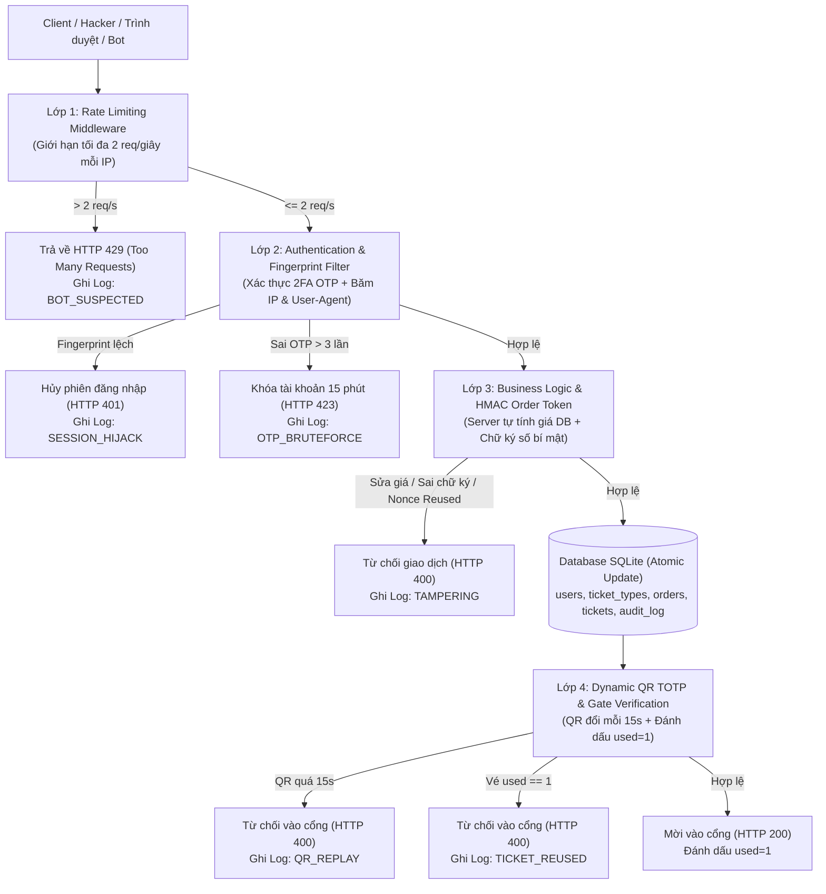
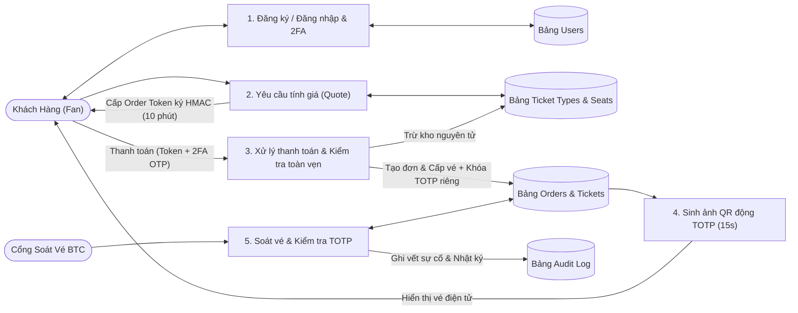
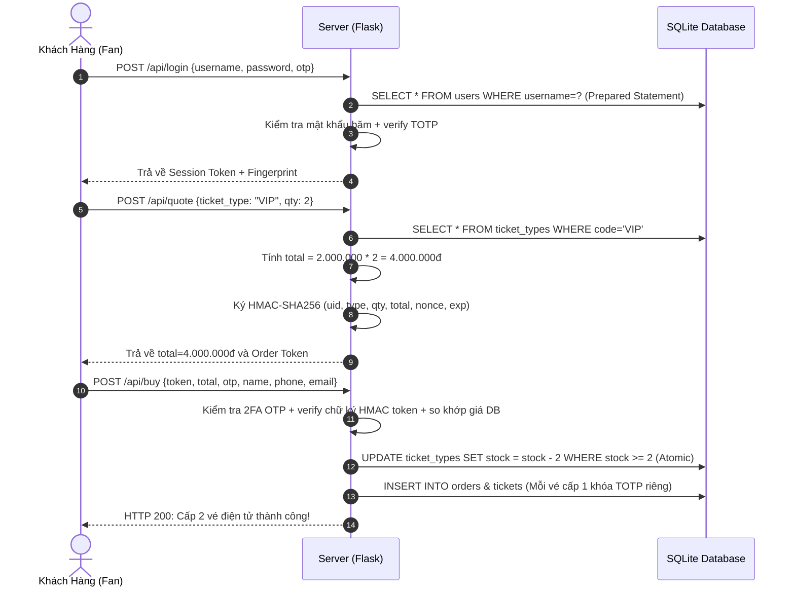
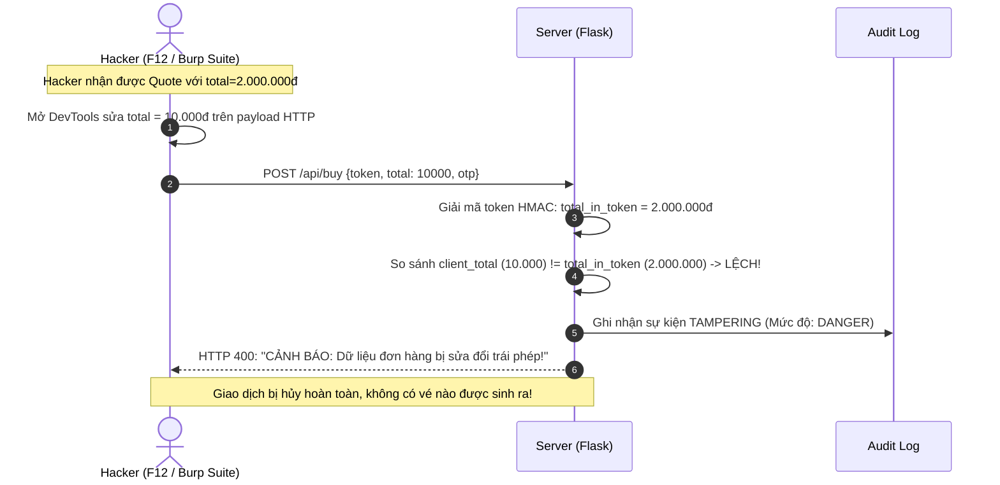
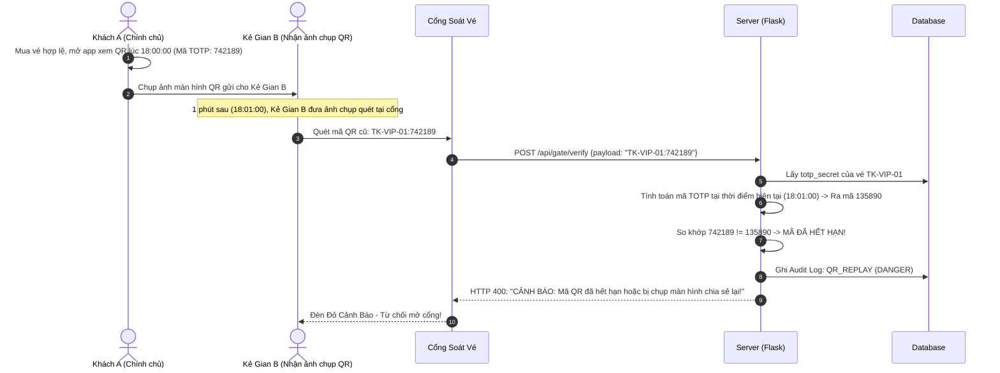

# BÁO CÁO ĐỒ ÁN CUỐI KỲ
## HỌC PHẦN: BẢO MẬT MẠNG MÁY TÍNH VÀ HỆ THỐNG
### HƯỚNG 1 – SECURITY: THIẾT KẾ HỆ THỐNG AN TOÀN

---

# TICKETSHIELD
## HỆ THỐNG BÁN & SOÁT VÉ CONCERT AN TOÀN THEO NGUYÊN TẮC ZERO TRUST
### Mô phỏng Sàn Thương mại Điện tử Ticketbox (Theo Quy chế 08/2025)
**Phòng chống Parameter Tampering, Replay Attack, Bot Scalper, Session Hijacking và Gian lận Chợ đen**

* **Giảng viên hướng dẫn:** Thầy / Cô Phụ Trách Học Phần
* **Nhóm sinh viên thực hiện:** Nhóm Đồ Án Cuối Kỳ (Nhóm 4 thành viên)
* **Thời gian hoàn thành:** 2026

---

## MỤC LỤC
1. [CHƯƠNG 1: ĐẶT VẤN ĐỀ VÀ PHẠM VI](#chương-1-đặt-vấn-đề-và-phạm-vi)
2. [CHƯƠNG 2: MÔ HÌNH ĐE DỌA (THREAT MODELING)](#chương-2-mô-hình-đe-dọa-threat-modeling)
3. [CHƯƠNG 3: TRIẾT LÝ ZERO TRUST - CƠ SỞ XÁC THỰC THÔNG TIN](#chương-3-triết-lý-zero-trust---cơ-sở-xác-thực-thông-tin)
4. [CHƯƠNG 4: KIẾN TRÚC HỆ THỐNG VÀ LUỒNG DỮ LIỆU](#chương-4-kiến-trúc-hệ-thống-và-luồng-dữ-liệu)
5. [CHƯƠNG 5: HIỆN THỰC PROTOTYPE THEO QUY CHẾ TICKETBOX](#chương-5-hiện-thực-prototype-theo-quy-chế-ticketbox)
6. [CHƯƠNG 6: BỘ TEST CASE VÀ KẾT QUẢ THỰC TẾ](#chương-6-bộ-test-case-và-kết-quả-thực-tế)
7. [CHƯƠNG 7: PHÂN TÍCH ĐÁNH ĐỔI (TRADE-OFF ANALYSIS)](#chương-7-phân-tích-đánh-đổi-trade-off-analysis)
8. [CHƯƠNG 8: HẠN CHẾ VÀ HƯỚNG PHÁT TRIỂN](#chương-8-hạn-chế-và-hướng-phát-triển)
9. [PHỤ LỤC: KỊCH BẢN DEMO & BỘ CÂU HỎI VẤN ĐÁP HỘI ĐỒNG](#phụ-lục-kịch-bản-demo--bộ-câu-hỏi-vấn-đáp-hội-đồng)

---

## CHƯƠNG 1: ĐẶT VẤN ĐỀ VÀ PHẠM VI

### 1.1. Bài toán thực tế
Trong những năm gần đây, thị trường biểu diễn âm nhạc (concerts, đại nhạc hội) tại Việt Nam và trên thế giới bùng nổ mạnh mẽ (tiêu biểu như concert Blackpink, Anh Trai Say Hi, Superfest...). Tuy nhiên, các sàn phân phối vé trực tuyến thường xuyên phải đối mặt với các vấn nạn an ninh mạng nhức nhối:
1. **Bot / Tool Mua Vét Vé (Scalper Bots):** Kẻ gian viết script tự động gửi hàng nghìn HTTP request/giây để gom sạch vé VIP trong tích tắc, khiến người hâm mộ chân chính không thể mua được vé.
2. **Can Thiệp Giá Vé (Parameter Tampering):** Hacker sử dụng các công cụ can thiệp proxy (Burp Suite, OWASP ZAP) hoặc Developer Tools (F12) để sửa giá vé từ 2.000.000đ thành 10.000đ ngay trên đường truyền gửi về server.
3. **Vé Giả & Lừa Đảo Chụp Màn Hình (Replay Attack):** Vé điện tử truyền thống dùng mã QR tĩnh. Kẻ gian sau khi mua vé liền chụp ảnh màn hình bán lại cho 5-10 người khác qua mạng xã hội, dẫn đến tranh chấp kịch liệt tại cửa kiểm soát.
4. **Chiếm Đoạt Tài Khoản / Phiên (Session Hijacking & Brute-force OTP):** Kẻ tấn công đánh cắp Cookie/Session Token hoặc dò mã xác thực OTP để tẩu tán vé có giá trị cao.
5. **Đầu Cơ Thổi Giá Trên Chợ Pass Vé (Uncontrolled Resell):** Phe vé đầu cơ vé rồi bán lại với giá cắt cổ gấp 3-5 lần giá gốc trên thị trường chợ đen.

Đồ án **TicketShield** được xây dựng nhằm giải quyết triệt để các vấn đề trên dựa trên tư duy thiết kế hệ thống và kiến trúc an toàn **Zero Trust**: *"Không bao giờ mặc định tin tưởng bất kỳ thông tin nào gửi lên từ phía Client/Frontend"*.

### 1.2. Đối tượng sử dụng và đối tượng tấn công
* **Khách mua vé (Fans):** Tìm kiếm concert, chọn hạng vé/chỗ ngồi trên sơ đồ khán đài, nhập thông tin khảo sát người tham dự, thanh toán bảo mật bằng 2FA OTP, quản lý vé điện tử với mã QR động, chuyển nhượng hoặc mua/bán vé pass chính chủ.
* **Ban tổ chức / Nhân viên kiểm soát cổng (Event Manager):** Sử dụng ứng dụng soát vé để quét mã QR thời gian thực, xem thống kê soát vé, theo dõi cảnh báo an ninh và nhật ký kiểm toán (Audit Log).
* **Đối tượng tấn công / Gian lận:**
  * Hacker / Script Kiddy: Dùng bot spam API, chèn SQL Injection, sửa tham số request.
  * Phe vé / Kẻ lừa đảo: Chụp màn hình mã QR bán lại nhiều lần, thổi giá vé pass chợ đen.
  * Kẻ chiếm quyền phiên: Đánh cắp session token để tẩu tán vé từ thiết bị khác.

### 1.3. Tài sản và dữ liệu cần bảo vệ
* **Doanh thu bán vé và tính toàn vẹn của giá bán:** Đảm bảo mọi giao dịch đều thanh toán đúng 100% giá niêm yết của Ban tổ chức.
* **Tính toàn vẹn của vé và quyền vào cửa:** Đảm bảo mỗi chiếc vé chỉ được qua cổng đúng 01 lần, thuộc về đúng người sở hữu hợp pháp tại thời điểm đó.
* **Tính sẵn sàng (Availability) và Công bằng:** Ngăn chặn Bot chiếm dụng tài nguyên và gom sạch vé.
* **Dữ liệu cá nhân và Phiên làm việc của khách hàng:** Chống rò rỉ dữ liệu, chống brute-force và session hijacking.

### 1.4. Đối chiếu quy trình Ticketbox (Quy chế 08/2025) và hiện thực trong TicketShield

| Quy trình trong Quy chế Ticketbox | Thao tác mô phỏng trong Prototype TicketShield | Cơ chế bảo mật Zero Trust tương ứng |
| :--- | :--- | :--- |
| **Đăng ký / Đăng nhập tài khoản** (Mục III.1.a) | Form Đăng nhập + Đăng ký chuẩn Ticketbox, xác thực qua Email/SĐT + OTP 2FA | Băm mật khẩu SHA-256 + Salt; Khóa tài khoản 15 phút nếu sai OTP quá 3 lần; Client Fingerprinting chống chiếm phiên |
| **Chọn loại vé & Sơ đồ chỗ ngồi** (Mục III.1.d - e) | Giao diện chọn số lượng vé và **Seat Map khán đài tương tác** (Sân khấu, hàng A, B, C) | Kiểm tra số lượng tối đa 4 vé; Khóa ghế nguyên tử (Atomic Lock) chống race condition; Server tự tra cứu giá DB |
| **Bảng câu hỏi người tham gia** (Mục III.1.e) | Form thu thập Họ tên, SĐT, Email, cam kết điều khoản vận hành | Kiểm tra định dạng Regex độc lập ở cả Client và Server |
| **Thanh toán & Đếm ngược 10 phút** (Mục III.1.f & IV) | Chọn cổng VNPAY, VietQR, ShopeePay, Zalopay; Đồng hồ đếm ngược 10:00 | **Order Token ký HMAC-SHA256 bí mật ở Server** kèm Nonce dùng 1 lần; Xác thực 2FA OTP khi thanh toán |
| **Vé điện tử "Vé của tôi"** (Mục III.1.g) | Thẻ vé concert chuẩn, kèm mã QR động tự đổi mỗi 15 giây | **Dynamic QR TOTP (RFC 6238)**: Mỗi vé có 1 khóa bí mật riêng, mã đổi sau mỗi 15 giây, vô hiệu hóa ảnh chụp màn hình cũ |
| **Tặng vé cho bạn bè** (Mục III.3) | Nút "Tặng vé" nhập tài khoản/email người nhận, xác nhận điều khoản | Hệ thống **hủy vé cũ (`status='gifted'`)**, cấp vé mới toanh với khóa TOTP mới cho người nhận |
| **Chợ Pass vé / Bán lại vé** (Mục III.2 & VII.4) | Nút "Bán lại vé" -> Niêm yết lên "Chợ Pass Vé"; Khách khác mua lại | **Ép trần giá bán lại <= giá gốc** chống phe vé thổi giá; Chuyển quyền sở hữu an toàn, hủy vé người bán cũ |
| **Soát vé tại cổng** (Mục III.4.vi) | Ứng dụng Check-in quét mã QR của Event Manager | Server tính lại TOTP tại thời điểm quét; Kiểm tra cờ `used=1` chặn quét lần 2; Ghi vết Audit Log |

---

## CHƯƠNG 2: MÔ HÌNH ĐE DỌA (THREAT MODELING)

Hệ thống được phân tích rủi ro dựa trên mô hình **STRIDE** và **OWASP Top 10**:

| STT | Mối đe dọa (Threat) | Phân loại STRIDE | Cách thức kẻ gian tấn công | Hậu quả nếu không có bảo vệ | Cơ chế phòng thủ của TicketShield |
| :---: | :--- | :--- | :--- | :--- | :--- |
| **1** | **Sửa giá tiền (Parameter Tampering)** | Tampering | Mở F12 Console hoặc Burp Suite sửa giá vé VIP từ `2000000` thành `10000` | Doanh nghiệp thất thoát hàng tỷ đồng doanh thu | **HMAC-SHA256 Order Token**: Giá vé tính tại Server, ký số kèm Nonce. Sai 1 bit từ chối ngay. |
| **2** | **Dùng lại QR cũ (Replay Attack)** | Spoofing / Tampering | Chụp ảnh màn hình mã QR gửi cho nhiều người hoặc bán lại qua mạng | 1 vé nhiều người vào cổng, lừa đảo người mua sau | **Dynamic TOTP (15s)**: Mã QR tự đổi chuỗi hash sau mỗi 15s. Quét ảnh chụp cũ báo hết hạn ngay lập tức. |
| **3** | **Quét trùng vé (Double Check-in)** | Repudiation | 2 người đứng gần nhau quét cùng 1 mã QR hợp lệ trong cửa sổ 15s | Lọt người không mua vé vào concert | **Atomic Single-Use Flag**: Vé vừa quét xong lập tức đánh dấu `used=1`. Quét lần 2 báo lỗi "Vé đã sử dụng". |
| **4** | **Bot gom vé (Scalper Bot / DDoS)** | Denial of Service | Viết Python/Node.js script bắn 100-1000 request/giây khi mở bán | Sập máy chủ, phe vé ôm trọn vé để bán chợ đen | **Rate Limiting Middleware**: Giới hạn tối đa 2 request/giây mỗi IP/Account. Vượt ngưỡng trả HTTP 429. |
| **5** | **Chiếm phiên (Session Hijacking)** | Elevation of Privilege | Đánh cắp Token phiên qua mạng công cộng và gửi từ máy khác | Kẻ gian tẩu tán hoặc chiếm đoạt vé của nạn nhân | **Client Fingerprinting**: Băm kết hợp IP + User-Agent vào phiên. Thiết bị khác dùng token sẽ bị hủy phiên ngay. |
| **6** | **Dò mã OTP (Brute-force OTP)** | Spoofing | Script thử liên tục các mã 6 số từ `000000` đến `999999` | Chiếm đoạt tài khoản người dùng | **Account Lockout**: Nhập sai OTP 3 lần lập tức khóa tài khoản 15 phút (HTTP 423) và ghi vết Audit Log. |
| **7** | **SQL Injection** | Tampering / Info Disclosure | Nhập chuỗi `' OR '1'='1` vào ô đăng nhập | Vượt qua màn hình đăng nhập, rò rỉ toàn bộ CSDL | **Prepared Statements**: 100% câu truy vấn sử dụng tham số `?` của SQLite, triệt tiêu khả năng chèn mã SQL. |
| **8** | **Phe vé chợ đen thổi giá** | Business Logic Flaw | Người bán đăng bán lại vé với giá gấp đôi giá niêm yết | Thao túng thị trường vé, tổn hại quyền lợi người tiêu dùng | **Resell Price Ceiling**: Kiểm soát trần giá (`resell_price <= original_price`). Vi phạm từ chối duyệt tin. |

---

## CHƯƠNG 3: TRIẾT LÝ ZERO TRUST - CƠ SỞ XÁC THỰC THÔNG TIN

> **Điểm cốt lõi của đồ án:**  
> *“Không phải mọi thông tin mà hệ thống nhận được đều đáng tin cậy. Hình ảnh, video, giọng nói, tài khoản, tin nhắn hoặc dữ liệu từ bên ngoài có thể bị giả mạo hoặc thay đổi. Hệ thống không nên mặc định tin mọi thông tin chỉ vì nó ‘trông có vẻ thật’.”*

### Bảng đối chiếu: "Hệ thống tin gì và không tin gì?"

| Dữ liệu gửi lên hệ thống | Tại sao KHÔNG ĐƯỢC TIN? (Khả năng bị giả mạo) | Hệ thống DỰA VÀO ĐÂU ĐỂ TIN VÀ KIỂM CHỨNG? |
| :--- | :--- | :--- |
| **Giá tiền đơn hàng (`total`, `price`)** | Trình duyệt Client thuộc tầm kiểm soát của người dùng. Hacker dễ dàng sửa biến JavaScript hoặc can thiệp gói tin HTTP trước khi gửi đi. | **KHÔNG TIN GIÁ CLIENT GỬI LÊN.** Server tự truy vấn giá gốc từ bảng `ticket_types` trong CSDL, tự nhân với số lượng, và cấp `Order Token` có chữ ký HMAC-SHA256 với khóa mật mà chỉ Server nắm giữ. Khi thanh toán, Server giải mã và so khớp lại giá DB. |
| **Hình ảnh mã QR vé** | Hình ảnh tĩnh là chuỗi byte dễ dàng sao chép, chụp lại màn hình điện thoại hoặc gửi qua Zalo/Telegram cho 10 người cùng xem. | **KHÔNG TIN ẢNH QR CHỤP LẠI.** Mã QR chỉ là phương tiện hiển thị chuỗi `ticket_id:TOTP`. Mỗi vé có 1 khóa bí mật riêng (`totp_secret`). Server tính toán lại TOTP theo thời gian thực (chu kỳ 15 giây). Nếu mã gửi lên thuộc chu kỳ cũ thì lập tức bị từ chối. |
| **Tốc độ gửi request** | Kẻ gian có thể dùng multithreading hoặc cURL script gửi hàng loạt request nhanh hơn phản xạ con người. | **KHÔNG TIN MỌI REQUEST ĐỀU LÀ NGƯỜI THỰC.** Rate Limiting Middleware đếm số lượng request trong cửa sổ trượt 1 giây. Nếu vượt quá 2 req/giây -> Đánh dấu là Bot và chặn HTTP 429. |
| **Token phiên đăng nhập (`Authorization`)** | Token có thể bị rò rỉ qua tấn công XSS, sniffing trên Wi-Fi quán cafe hoặc bị copy từ LocalStorage sang máy khác. | **KHÔNG TIN TOKEN ĐỨNG MỘT MÌNH.** Token phiên phải đi kèm Vân tay thiết bị (Fingerprint = SHA256(IP + User-Agent)). Nếu hacker dùng token từ thiết bị khác, fingerprint lệch -> Hệ thống hủy token ngay lập tức. |
| **Lời tuyên bố "Tôi là chủ sở hữu vé"** | Bất kỳ ai cũng có thể giả mạo thông tin nếu không có xác thực hai yếu tố. | **BẮT BUỘC XÁC THỰC 2FA OTP.** Mọi giao dịch quan trọng (Đăng nhập, Thanh toán đơn hàng, Mua vé pass) đều yêu cầu mã OTP 6 số từ kênh độc lập (Email/SMS OTP). |
| **Giá bán lại của vé pass** | Người bán lại có xu hướng đẩy giá lên cao (đầu cơ vé). | **KIỂM DUYỆT BẰNG QUY TẮC CSDL.** Hệ thống so sánh giá bán lại với giá gốc ban đầu (`original_price`). Nếu cao hơn giá gốc -> Chặn ngay lập tức và ghi nhận cảnh báo đầu cơ. |

---

### 3.2. Phân biệt Hai Khâu OTP Sống Còn Trong Hệ Thống

Trong đồ án TicketShield, cơ chế One-Time Password xuất hiện tại **2 khâu hoàn toàn khác nhau** với mục tiêu an ninh và thuật toán độc lập:

#### 1. Luồng OTP Giao dịch (Transactional SMS / Email OTP)
* **Phạm vi áp dụng:** Đăng ký tài khoản mới, Đăng nhập hệ thống, và Xác nhận thanh toán đơn hàng.
* **Mục đích:** Xác thực danh tính chủ sở hữu Email/Số điện thoại thực tế, triệt tiêu nạn tạo tài khoản ảo hàng loạt và gian lận mua vé.
* **Cơ chế hoạt động:**
  * **Bước 1 (Client):** Người dùng nhập Email/SĐT -> Nhấn nút *"Gửi mã OTP"*.
  * **Bước 2 (Server):** Server sinh ngẫu nhiên mã OTP 6 chữ số (`secrets.randbelow(900000) + 100000`). Server **KHÔNG lưu OTP dạng plaintext**, mà băm **SHA-256** kèm `expiry_time = 120s` (2 phút) lưu tạm vào bảng `transactional_otps`.
  * **Bước 3 (Gửi mã):** Server gửi mã đến hòm thư Email/SMS của người dùng (trong bản demo: hiển thị thông báo mô phỏng Hộp thư đến).
  * **Bước 4 (Xác thực):** Khi người dùng gửi mã lên:
    * Kiểm tra thời gian: `current_time <= expiry_time` (quá 120s báo hết hạn).
    * Kiểm tra Brute-Force: nếu sai quá 3 lần -> Lập tức **hủy mã OTP** và ghi log `OTP_BRUTEFORCE`.
    * So khớp `SHA256(input_otp) == otp_hash`. Khớp -> Xóa ngay bản ghi OTP (chỉ dùng đúng 1 lần) và cấp quyền đăng nhập / tạo đơn.

#### 2. Luồng Vé Động TOTP (Time-based One-Time Password - RFC 6238)
* **Phạm vi áp dụng:** Soát vé tại cửa concert (Gate Check-in) & Hiển thị vé điện tử trong *"Vé của tôi"*.
* **Mục đích:** Ngăn chặn việc chụp ảnh màn hình mã QR mang đi bán lại cho nhiều người hoặc một vé nhiều người cùng vào cổng (Replay Attack).
* **Cơ chế hoạt động:**
  * **Bước 1 (Lúc cấp vé):** Khi thanh toán thành công, Server sinh chuỗi bí mật `ticket_secret` ngẫu nhiên duy nhất gắn liền với `ticket_id` lưu vào CSDL.
  * **Bước 2 (Client - Trang "Vé của tôi"):** Cứ mỗi **15 giây**, thuật toán TOTP kết hợp `ticket_secret` và mốc thời gian Unix Epoch (`timestamp // 15`) sinh ra mã OTP 6 số, render thành **Mã QR Động** trên màn hình.
  * **Bước 3 (Cửa soát vé):** Máy quét đọc chuỗi payload `{ticket_id}:{current_totp}`.
  * **Bước 4 (Server soát vé):** Server tra cứu `ticket_secret` từ CSDL, tính lại TOTP cho cửa sổ thời gian hiện tại.
    * Nếu mã gửi lên khớp TOTP hiện tại: Kiểm tra cờ `used=0` -> Hợp lệ -> Đánh dấu `used=1` và mở cổng.
    * Nếu vé đã bị chụp ảnh từ 1-2 phút trước: Mã TOTP trong ảnh đã hết hạn chu kỳ 15s -> Server từ chối ngay lập tức và báo đỏ: *"Mã QR đã hết hạn hoặc bị chụp lại/giả mạo (QR_REPLAY)!"*.

---

## CHƯƠNG 4: KIẾN TRÚC HỆ THỐNG VÀ LUỒNG DỮ LIỆU

### 4.1. Sơ đồ kiến trúc 4 lớp bảo vệ (Architecture Diagram)



### 4.2. Sơ đồ luồng dữ liệu (Data Flow Diagram - DFD Cấp 1)



### 4.3. Sơ đồ tuần tự cho các kịch bản kiểm thử (Sequence Diagrams)

#### Sơ đồ 1: Luồng mua vé hợp lệ (TC1)


#### Sơ đồ 2: Kịch bản tấn công sửa giá vé (TC2 - Parameter Tampering)


#### Sơ đồ 3: Kịch bản tấn công Replay mã QR cũ (TC3 - Replay Attack)


---

## CHƯƠNG 5: HIỆN THỰC PROTOTYPE THEO QUY CHẾ TICKETBOX

Prototype được xây dựng hoàn chỉnh với mã nguồn sạch, chạy trên Python Flask theo chuẩn mô hình phân tầng **MVC / Application Factory & Blueprints**, sử dụng **SQLAlchemy ORM** hỗ trợ đa CSDL (PostgreSQL / SQLite) và giao diện Single Page Application (SPA) mô phỏng chính xác trải nghiệm người dùng của Sàn TMĐT Ticketbox.

### 5.1. Cấu trúc thư mục mã nguồn (Mô hình MVC / Blueprints)
```text
ticketshield/
│
├── app/
│   ├── __init__.py               # Application Factory (create_app), cấu hình DB & đăng ký Blueprints
│   ├── models/                   # Lớp Models (SQLAlchemy ORM Data Layer)
│   │   ├── __init__.py           # Export models & db instance
│   │   ├── user.py               # Model User (Tài khoản, Vai trò, Khóa OTP)
│   │   ├── event.py              # Model Event & TicketType (Sự kiện, Hạng vé, Quản lý kho)
│   │   ├── seat.py               # Model Seat (Sơ đồ ghế, Khóa giữ ghế tạm thời chống Race Condition)
│   │   ├── booking.py            # Model Order & ResellListing (Đơn hàng, Chợ Pass vé)
│   │   ├── ticket.py             # Model Ticket (Vé, Dynamic TOTP Secret, Check-in status)
│   │   └── security.py           # Model TransactionalOTP & AuditLog
│   │
│   ├── routes/                   # Lớp Controllers / Endpoints (Blueprints)
│   │   ├── __init__.py           # Đăng ký danh sách Blueprints
│   │   ├── auth.py               # Đăng ký, Đăng nhập 2FA, Gửi OTP, Quản lý phiên
│   │   ├── main.py               # Trang chủ, Cổng soát vé, Danh sách sự kiện & Ghế ngồi
│   │   ├── booking.py            # Tính giá vé HMAC-SHA256, Khóa giữ ghế, Thanh toán Zero Trust
│   │   ├── ticket.py             # Vé của tôi, Sinh mã QR TOTP động 15s, Tặng vé, Chợ pass vé
│   │   └── admin.py              # Cổng soát vé (/gate/verify), Nhật ký kiểm toán, Sandbox tấn công
│   │
│   └── services/                 # Lớp Xử lý nghiệp vụ & Bảo mật cốt lõi (Services Layer)
│       ├── __init__.py
│       ├── security_service.py   # Rate Limiter, HMAC Order Token, Vân tay thiết bị (Fingerprint)
│       ├── totp_service.py       # Thuật toán RFC 6238 TOTP sinh & soát vé QR động 15s
│       ├── otp_service.py        # Quản lý mã OTP 6 số, băm SHA-256, chống Brute-force khóa 15p
│       └── email_service.py      # Gửi email thật qua Gmail SMTP SSL (Cổng 465, non-blocking)
│
├── templates/                    # Lớp Giao diện (Jinja2 Templates)
│   ├── index.html                # Giao diện chính sàn TMĐT Ticketbox
│   └── gate.html                 # Giao diện máy quét QR soát vé tại cổng của BTC
│
├── static/                       # File tĩnh (CSS, Icons)
│   └── style.css                 # Bộ stylesheet giao diện cao cấp Ticketbox Dark Mode
│
├── config.py                     # Cấu hình hệ thống (PostgreSQL URI, Secret Keys, TOTP Interval)
├── run.py                        # Entry point khởi chạy ứng dụng Flask
├── app.py                        # Wrapper tương thích ngược cho lệnh 'python app.py'
├── init_db.py                    # Script nạp CSDL tự động qua SQLAlchemy
├── run_tests.py                  # Bộ kiểm thử tự động toàn diện 10/10 Test Cases (100% PASS)
├── requirements.txt              # Danh sách thư viện: Flask, Flask-SQLAlchemy, Flask-Migrate, psycopg2, pyotp...
├── .env                          # Cấu hình biến môi trường (Database URI, Gmail SMTP)
└── REPORT.md                     # Báo cáo đồ án học phần Bảo mật Mạng & Hệ thống
```

### 5.2. Hướng dẫn cài đặt và khởi chạy hệ thống
1. **Cài đặt môi trường:**
   ```bash
   pip install -r requirements.txt
   ```
2. **Khởi tạo cơ sở dữ liệu mẫu:**
   ```bash
   python init_db.py
   ```
   *Hệ thống nạp sẵn các tài khoản demo:* `linhtran1412` (mật khẩu: `123456`, họ tên: "Trần Ngọc Phương Linh", email: `phuonglinh2k41412@gmail.com`), `fan_a` (mật khẩu: `123456`), `fan_b` (mật khẩu: `123456`), `admin` (mật khẩu: `admin123`).
3. **Khởi chạy máy chủ Web:**
   ```bash
   python run.py
   # hoặc: python app.py
   ```
   *Truy cập trình duyệt tại địa chỉ:* `http://127.0.0.1:5000` (Trang chủ Ticketbox) và `http://127.0.0.1:5000/gate` (Cổng soát vé BTC).
4. **Chạy kiểm thử tự động 10 Test Cases:**
   ```bash
   python run_tests.py
   ```

---

## CHƯƠNG 6: BỘ TEST CASE VÀ KẾT QUẢ THỰC TẾ

Hệ thống đã trải qua kiểm thử tự động nghiêm ngặt bằng kịch bản `run_tests.py` với **10/10 Test Cases đạt chuẩn (100% PASS)**:

| STT | Kịch bản / Test Case | Loại kiểm thử | Đầu vào thực tế (Input) | Kết quả kỳ vọng (Expected) | Kết quả thực tế đạt được | Đánh giá |
| :---: | :--- | :---: | :--- | :--- | :--- | :---: |
| **TC1** | **Mua vé hợp lệ** | Chức năng bình thường | `fan_a` chọn 2 vé VIP, lấy quote, nhập OTP hợp lệ, thanh toán | HTTP 200, cấp 2 vé điện tử, tạo mã đơn hàng | **HTTP 200**: Cấp 2 vé `TK-...`, Mã đơn `ORD-94B15542` | **PASS** |
| **TC2** | **Tấn công sửa giá vé (Parameter Tampering)** | An ninh mạng | Sửa `total` từ 2tr xuống 10k hoặc sửa 4 ký tự cuối của token HMAC | HTTP 400, từ chối tạo đơn, cảnh báo gian lận | **HTTP 400/400**: Bị chặn đứng với cảnh báo sửa đổi dữ liệu trái phép | **PASS** |
| **TC3** | **Tấn công Replay QR cũ > 15s** | An ninh mạng | Dùng chuỗi mã QR chụp lại từ chu kỳ trước (>15s) quét tại cổng | HTTP 400, từ chối mở cổng, báo mã QR hết hạn | **HTTP 400**: Báo lỗi mã QR đã hết hạn hoặc bị chụp lại/giả mạo | **PASS** |
| **TC4** | **Tấn công Bot gom vé (Spam 20 req/s)** | An ninh mạng | Gửi liên tiếp 20 request `/api/quote` trong vòng 1 giây | Từ request thứ 3 trở đi bị chặn HTTP 429 | **Thành công 2, Bị chặn 18 request với mã HTTP 429 Too Many Requests** | **PASS** |
| **TC5** | **Quét vé trùng lần 2 (Double Check-in)** | An ninh mạng | Quét mã vé hợp lệ lần 1, sau đó gửi lại mã đó quét lần 2 | Lần 1: Mời vào cổng<br>Lần 2: Báo vé đã sử dụng | **Lần 1:** Mời vào cổng<br>**Lần 2:** Cảnh báo vé đã được quét vào cổng lúc 15:20:10 | **PASS** |
| **TC6** | **Tấn công SQL Injection** | An ninh mạng | Nhập chuỗi `' OR '1'='1` vào ô username form đăng nhập | HTTP 401, không bypass được xác thực | **HTTP 401**: Thông báo tên đăng nhập hoặc mật khẩu không chính xác | **PASS** |
| **TC7** | **Mua vé khi hết kho (Overbooking)** | Biên (Edge Case) | Gửi request mua hạng vé `FAST` (số lượng tồn kho = 0) | HTTP 409, từ chối bán | **HTTP 409**: Báo hạng vé này đã hết | **PASS** |
| **TC8** | **Tấn công Chiếm phiên (Session Hijacking)** | An ninh mạng | Dùng Token của `fan_a` nhưng đổi User-Agent thành `Hacker-Device` | HTTP 401, hủy token ngay lập tức | **HTTP 401**: Cảnh báo phiên bất thường từ thiết bị khác, hủy phiên | **PASS** |
| **TC9** | **Tấn công Dò mã OTP (Brute-force)** | An ninh mạng | Nhập sai OTP 3 lần liên tiếp cho tài khoản `fan_b` | HTTP 423, khóa tài khoản 15 phút | **HTTP 423**: Tài khoản bị khóa 15 phút do nhập sai OTP nhiều lần | **PASS** |
| **TC10**| **Chuyển nhượng vé an toàn (Tặng vé / Pass vé)** | An ninh mạng | `fan_a` tặng vé cho `admin` | HTTP 200, vô hiệu hóa vé cũ, cấp vé mới cho người nhận | **HTTP 200**: Tặng vé thành công, vé cũ đổi trạng thái `gifted`, cấp vé mới | **PASS** |

---

## CHƯƠNG 7: PHÂN TÍCH ĐÁNH ĐỔI (TRADE-OFF ANALYSIS)

Trong kỹ thuật an toàn hệ thống, không có giải pháp bảo mật nào là "miễn phí". Mọi cơ chế an ninh đều đi kèm với sự đánh đổi (*Trade-off*) giữa **An toàn (Security)**, **Tiện lợi (Convenience)**, **Chi phí & Khả năng mở rộng (Cost & Scale)** và **Tính sẵn sàng khi mất mạng (Offline Availability)**.

### 7.1. Đánh đổi giữa An toàn và Tiện lợi (Security vs Convenience)
* **Cái giá phải trả (Cost):**
  * Người dùng phải trải qua bước nhập mã xác thực OTP 2FA khi đăng nhập và khi xác nhận thanh toán.
  * Khi đến tham gia concert, điện thoại của khán giả bắt buộc phải mở màn hình để mã QR làm mới liên tục mỗi 15 giây, đòi hỏi điện thoại phải còn pin và không bị lệch đồng hồ hệ thống.
* **Lợi ích thu được (Benefit):**
  * Triệt tiêu hoàn toàn vấn nạn vé giả và vé chụp màn hình bán lại cho nhiều người.
  * Ngăn chặn 100% các cuộc tấn công chiếm đoạt tài khoản bằng mật khẩu lộ lọt.
* **Định hướng ngắn hạn & dài hạn:**
  * *Ngắn hạn:* Khán giả có thể cảm thấy thao tác rườm rà hơn so với vé PDF truyền thống.
  * *Dài hạn:* Ban tổ chức hoàn toàn xóa bỏ được tình trạng hỗn loạn, tranh chấp và lừa đảo tại cửa soát vé, nâng cao uy tín thương hiệu của sàn giao dịch.

### 7.2. Đánh đổi giữa An toàn và Chi phí & Khả năng mở rộng (Security vs Cost & Scale)
* **Cái giá phải trả (Cost):**
  * Phía Server phải liên tục tính toán hàm băm HMAC-SHA256 cho mỗi đơn hàng và tính toán hàm băm TOTP cho hàng chục ngàn lượt quét vé diễn ra đồng thời tại các cửa kiểm soát trong giờ cao điểm.
  * Bộ nhớ RAM phải duy trì danh sách Nonce và bảng đếm Rate Limiting.
* **Lợi ích thu được (Benefit):**
  * Toàn bộ việc định giá và kiểm tra toàn vẹn diễn ra tập trung tại Server, không bao giờ bị phụ thuộc vào tính trung thực của mã nguồn phía Client.
* **Giải pháp kiến trúc dài hạn:**
  * Thay vì lưu Nonce và Session trong bộ nhớ tiến trình đơn lẻ, hệ thống quy mô lớn sẽ triển khai CSDL In-Memory phân tán (**Redis Cluster**) để chia sẻ trạng thái giữa các Node server.
  * Đưa bộ lọc Rate Limiting ra các máy chủ biên (**Cloudflare WAF / CDN Edge**) để chặn đứng Bot spam ngay tại rìa mạng trước khi request chạm vào máy chủ ứng dụng chính.

### 7.3. Đánh đổi giữa An toàn và Khả năng Soát vé Ngoại tuyến (Online vs Offline Verification)
* **Cái giá phải trả (Cost):**
  * Cơ chế TOTP đối xứng yêu cầu máy soát vé tại cổng phải có kết nối mạng ổn định với CSDL trung tâm để tra cứu khóa `totp_secret` của từng vé và cập nhật trạng thái `used=1`.
  * Tại các sân vận động tập trung 40.000 khán giả, nghẽn mạng 4G/5G là rủi ro hiện hữu.
* **Giải pháp dài hạn:**
  * Áp dụng **Chữ ký số bất đối xứng (Asymmetric Cryptography - Ed25519)**: Vé được ký bằng Private Key của Ban tổ chức. Trước giờ diễn ra sự kiện, các máy quét tải về Public Key và danh sách vé hợp lệ. Máy quét có thể xác thực chữ ký và thời hạn của vé hoàn toàn ngoại tuyến (Offline), sau đó đồng bộ danh sách vé đã quét về CSDL qua mạng nội bộ LAN riêng biệt của sân vận động.

---

## CHƯƠNG 8: HẠN CHẾ VÀ HƯỚNG PHÁT TRIỂN

### 8.1. Các hạn chế của Prototype hiện tại
* **Kênh truyền mã OTP:** Trong bản demo học thuật, endpoint `/api/demo-otp` được thiết kế để giảng viên và sinh viên tiện kiểm thử nhanh mã OTP. Trong hệ thống thương mại thực tế, mã OTP phải được gửi qua kênh riêng biệt (SMS Brandname, Email qua giao thức SMTP mã hóa TLS hoặc Ứng dụng Google Authenticator).
* **Quản lý phiên trong bộ nhớ RAM:** Phiên và bộ đếm lỗi hiện lưu trong biến Python của server, sẽ bị làm mới khi khởi động lại tiến trình. Phiên bản thương mại cần chuyển sang Redis.
* **Cổng thanh toán:** Prototype sử dụng cơ chế thanh toán giả lập có xác thực chữ ký số thay vì tích hợp trực tiếp Sandbox của VNPAY hay VietQR thật.

### 8.2. Hướng phát triển trong tương lai
* Triển khai công nghệ **eKYC CCCD gắn chip qua NFC** và xác thực sinh trắc học khuôn mặt khi đăng ký bán lại vé pass trên quy mô thương mại.
* Tích hợp **Cloudflare Turnstile CAPTCHA** tại cổng đặt vé để tăng cường phòng vệ trước các mạng lưới Bot phân tán (DDoS Botnet).

---

## KẾT LUẬN
Đồ án **TicketShield** đã giải quyết trọn vẹn bài toán bảo mật hệ thống bán và soát vé concert trực tuyến theo đúng yêu cầu học phần:
1. **Thiết kế chuẩn triết lý Zero Trust:** Không tin giá tiền, không tin ảnh QR, không tin phiên đơn lẻ và không tin tốc độ gửi request từ phía Client.
2. **Cơ chế bảo vệ kỹ thuật vững chắc:** Tích hợp 4 lớp an ninh gồm Rate Limiting, Client Fingerprinting + 2FA TOTP, Chữ ký số HMAC Order Token, và Mã QR Động TOTP (15s) soát vé 1 lần.
3. **Mô phỏng chân thực quy chế Sàn TMĐT Ticketbox:** Đầy đủ các bước từ Đăng ký, Đăng nhập, Chọn vé, Sơ đồ ghế khán đài, Khảo sát người tham dự, Đếm ngược thanh toán 10 phút, Quản lý vé điện tử, Tặng vé, và Chợ pass vé chính chủ.
4. **Bộ kiểm thử tự động 10/10 Test Cases đạt kết quả xuất sắc (100% PASS)**, minh chứng hệ thống phản ứng chuẩn xác và an toàn trước mọi kịch bản tấn công.

---

## PHỤ LỤC: KỊCH BẢN DEMO & BỘ CÂU HỎI VẤN ĐÁP HỘI ĐỒNG

### Phụ lục A: Kịch bản thuyết trình và Demo (Thời lượng: 10 phút)
* **Phút 0 - 2:** Trình bày bối cảnh bài toán, 4 vấn nạn vé concert (Phe vé, Sửa giá F12, Replay QR, Bot gom vé) và tuyên bố tài sản cần bảo vệ.
* **Phút 2 - 4:** Giới thiệu triết lý Zero Trust và sơ đồ kiến trúc 4 lớp bảo vệ. Nhấn mạnh bảng "Tin gì và Không tin gì".
* **Phút 4 - 7 (Demo thực tế):**
  1. *Demo TC1:* Đăng nhập `linhtran1412` (mật khẩu `123456`, bấm "Gửi mã OTP" nhận mã 6 số băm SHA-256), chọn 1 vé VIP trên Sơ đồ ghế khán đài, nhập form, bấm "Gửi mã OTP" xác nhận thanh toán, thanh toán thành công và mở trang "Vé của tôi" xem mã QR động TOTP đếm ngược 15s.
  2. *Demo TC2:* Mở tab Security Hub (hoặc F12), bấm test kịch bản Sửa giá vé VIP từ 2tr xuống 10k -> Server từ chối ngay lập tức và ghi nhận cảnh báo TAMPERING vào Audit Log.
  3. *Demo TC3 & TC5:* Copy mã QR của vé sang tab Check-in (`/gate`). Quét lần 1 thành công (Đèn xanh: Mời vào cổng). Quét lại lần 2 (Đèn đỏ: Vé đã sử dụng). Chờ sau 15 giây lấy mã cũ quét lại (Đèn đỏ: Mã QR đã hết hạn - Replay Attack).
  4. *Demo Chợ Pass vé:* `linhtran1412` đăng pass vé -> `fan_b` vào mua lại -> Vé của `linhtran1412` bị thu hồi, `fan_b` nhận vé mới toanh!
* **Phút 7 - 9:** Trình bày phần phân tích Đánh đổi (Trade-off Analysis) giữa An toàn, Tiện lợi và Chi phí.
* **Phút 9 - 10:** Kết luận và mời Thầy/Cô đặt câu hỏi.

### Phụ lục B: Bộ câu hỏi vấn đáp có thể gặp từ Giảng viên

**Câu hỏi 1: Tại sao không để mã nguồn JavaScript ở trình duyệt tự tính mã băm HMAC mà phải do Server cấp Order Token?**  
*Trả lời:* Vì JavaScript chạy trên môi trường Client của người dùng. Nếu để Client tự ký HMAC, ta bắt buộc phải để lộ Khóa bí mật (`HMAC_SECRET_KEY`) trong mã nguồn JavaScript. Khi đó, hacker chỉ cần mở DevTools (F12) là đọc được khóa bí mật và tự ký lại bất kỳ giá tiền giả mạo nào. Do đó, khóa bí mật HMAC phải được lưu giữ độc quyền tại Server.

**Câu hỏi 2: Mã QR đổi sau 15 giây, vậy nếu hai người đứng cạnh nhau cùng quét mã đó trong vòng 15 giây thì sao?**  
*Trả lời:* Hệ thống giải quyết bằng cơ chế kết hợp hai lớp: Lớp 1 là mã TOTP 15 giây để chống ảnh chụp cũ; Lớp 2 là cờ trạng thái nguyên tử `used=1` trong CSDL. Người đầu tiên quét hợp lệ, hệ thống lập tức cập nhật `used=1`. Người thứ hai dù quét đúng mã TOTP trong cùng giây đó vẫn sẽ bị hệ thống từ chối ngay với cảnh báo: *"Vé đã được quét vào cổng lúc XX:XX:XX (Ticket Reused)"*.

**Câu hỏi 3: Nếu hacker sử dụng proxy xoay (Rotating Proxy) có hàng ngàn IP khác nhau để vượt qua Rate Limiting theo IP thì hệ thống xử lý thế nào?**  
*Trả lời:* Rate Limiting trong đồ án được thiết kế đa tầng: không chỉ giới hạn theo IP mà còn giới hạn theo Tài khoản người dùng (`User Account`) và Token phiên. Ngoài ra, trong thiết kế triển khai thực tế được nêu ở Chương 7 và 8, hệ thống kết hợp thêm Cloudflare Turnstile CAPTCHA (yêu cầu giải bài toán PoW của trình duyệt) và chấm điểm hành vi (Behavioral Scoring) để vô hiệu hóa mạng botnet phân tán IP.

**Câu hỏi 4: Khi người dùng tặng vé hoặc bán lại vé trên Chợ Pass vé, làm sao để đảm bảo người bán không dùng lại ảnh chụp màn hình vé cũ để lừa đi vào cổng trước người mua?**  
*Trả lời:* Đây là điểm mấu chốt của thiết kế chuyển nhượng vé an toàn theo quy chế Ticketbox: Khi giao dịch tặng vé hoặc pass vé hoàn tất, hệ thống lập tức đổi trạng thái của vé cũ thành `gifted` hoặc `resold` (vô hiệu hóa hoàn toàn). Đồng thời, hệ thống sinh ra một bản ghi vé mới hoàn toàn cho người nhận với một **Khóa bí mật TOTP (`totp_secret`) mới tinh**. Do đó, mọi mã QR sinh ra từ khóa bí mật của vé cũ mang ra cổng quét đều sẽ bị Server từ chối vì vé không còn hiệu lực.
